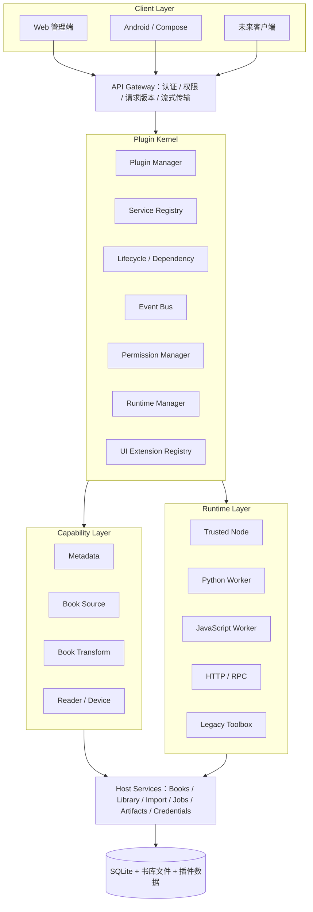
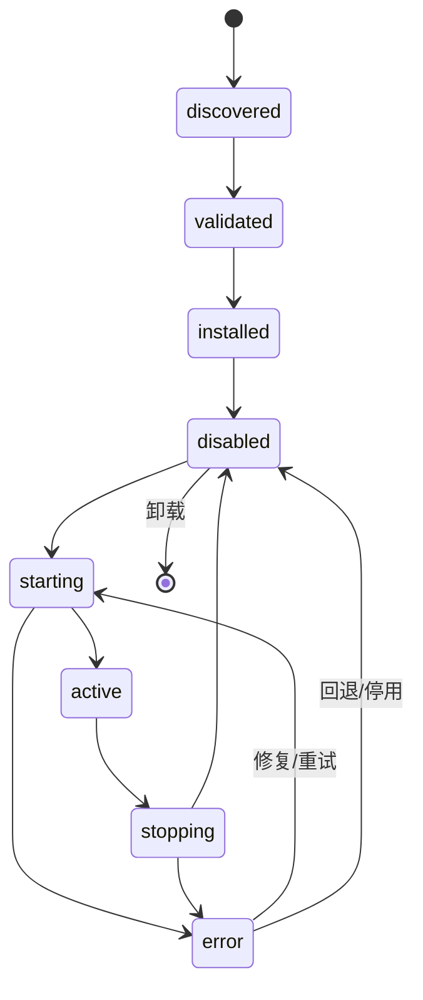
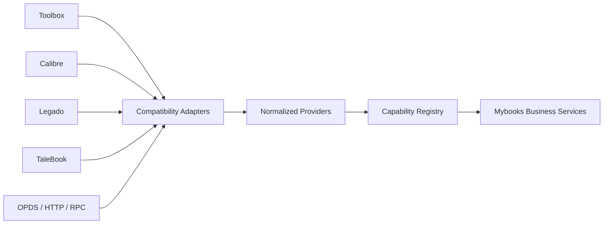

# Mybooks 通用插件平台总体架构设计与开发规划

> **项目**：Mybooks Universal Plugin Platform  
> **文档版本**：v1.0（目标架构规划）  
> **更新日期**：2026-11-09  
> **基础仓库**：[shyshineinn/mybooks-server](https://github.com/shyshineinn/mybooks-server)  
> **架构参考**：DeepSeek Harness / Cordis / TaleBook / Calibre / Legado / PoxenStudio/MyBooks  
> **相关规范**：[Mybooks 插件平台开发规范](./mybooks-plugin-development-standards.md)

> **阅读须知**：本文同时包含**经源码核实的现状**和**尚未落地的目标设计**。凡标注「目标／规划」的目录、协议、模块、流程，不代表当前仓库已经实现。当前仓库已有的 Toolbox 机制应保留并逐步纳入新内核。

## 目录

1. [项目定位与长期愿景](#第一章项目定位与长期愿景)
2. [现有架构与改造基础](#第二章现有架构与改造基础)
3. [未来总体技术架构](#第三章未来总体技术架构)
4. [微内核与插件组合架构](#第四章微内核与插件组合架构)
5. [Plugin Kernel 详细设计](#第五章plugin-kernel-详细设计)
6. [统一插件协议与 Manifest](#第六章统一插件协议与-manifest)
7. [多运行时架构](#第七章未来多运行时架构)
8. [第三方生态兼容](#第八章第三方插件生态兼容架构)
9. [Web / Android 插件 UI](#第九章未来-web--android-插件-ui-架构)
10. [任务与文件系统](#第十章统一任务与文件系统)
11. [插件商店与供应链](#第十一章插件商店与供应链管理)
12. [数据库与配置](#第十二章数据库及配置架构)
13. [安全与威胁模型](#第十三章安全架构与威胁模型)
14. [可观测性与运维](#第十四章可观测性与运维架构)
15. [目标代码结构](#第十五章目标代码目录结构)
16. [业务流程](#第十六章完整业务流程设计)
17. [分阶段实施](#第十七章实施路线与阶段性目标)
18. [测试与验收](#第十八章测试验收与兼容性规范)
19. [架构决策与风险](#第十九章关键架构决策与风险控制)
20. [完成标准](#第二十章最终目标与项目完成标准)

---

# 第一章：项目定位与长期愿景

## 1.1 项目定位

Mybooks 是以自部署、图书管理、电子书处理、多设备阅读为核心的平台。现阶段已有主业务系统及 Toolbox 兼容插件机制；长期目标是建设以 **Plugin Kernel** 为中心、以 **Capability API** 为统一契约的扩展平台。

插件不再仅是工具箱里的独立页面，而能够提供业务服务、扩展界面、订阅领域事件，并与其他插件通过受控接口协作。

## 1.2 长期目标

1. 面向预留扩展点，实现「一切可扩展能力皆可插件化」。
2. 通过语言无关协议支持 Python、JavaScript、HTTP/RPC 等执行方式。
3. 不同生态的插件经适配后提供一致的 Mybooks Capability。
4. 支持安装、启停、升级、回滚、卸载与故障恢复。
5. 支持 Web、Android 客户端消费插件能力并渲染受支持的扩展 UI。
6. 插件间通过服务接口、事件和任务协作，避免相互硬编码依赖。
7. 在不改变调用方业务代码的情况下替换部分内置 Provider。
8. 对第三方代码建立可执行的权限和隔离边界。
9. 用 Profile / Bundle 组合不同功能场景。
10. 在普通 Docker、NAS、小型 VPS 上保持可部署性与可维护性。

## 1.3 核心原则

| 原则 | 解释 |
| --- | --- |
| 微内核 | 内核只负责插件管理、服务发现、生命周期、权限和调度 |
| 能力优先 | 以标准业务能力而不是内部路由描述插件 |
| 稳定契约 | Consumer 依赖能力定义，Provider 可以替换 |
| 可逆注册 | 服务、事件、任务、UI 注册均可撤销 |
| 跨语言解耦 | Runtime Adapter 隐藏语言和进程差异 |
| 最小权限 | 每个敏感操作都由可信宿主检查授权 |
| 故障隔离 | 插件失败不应拖垮主进程和其他插件 |
| 渐进式兼容 | 旧 API、旧 Toolbox 和数据先保留 |
| 可观测 | 任务、错误、耗时、运行状态可追踪 |
| 自部署友好 | 不强制引入分布式集群平台 |

## 1.4 非初期目标

不重写整个后端；不一次性将认证、数据库和同步全部插件化；不承诺任意外部插件零适配；不把 Web JS 当作 Android 原生代码；不允许插件直接获取数据库凭据、Docker Socket 或宿主根文件系统。

---

# 第二章：现有架构与改造基础

## 2.1 当前技术架构（已核实）

| 系统层 | 现有实现 |
| --- | --- |
| 主服务 | Node.js + Express，CommonJS |
| 数据存储 | SQLite |
| Web | 原生 HTML / CSS / JavaScript |
| 图书系统 | 现有 Mybooks 核心业务模块 |
| 插件框架 | PoxenStudio/MyBooks Toolbox 兼容实现 |
| 插件运行 | Python 3.12 + Tornado，独立 Worker 容器 |
| 安装 | ZIP / 7z、Manifest、SHA-256、暂存与回滚 |
| 插件 UI | sandbox iframe + postMessage Bridge |
| 后台任务 | SQLite `toolbox_tasks` |
| 部署 | Docker Compose、自部署 |

## 2.2 已有关键文件

```text
server.js
src/core/toolbox/
  manifest.js  installer.js  store.js  runtime.js
  library.js   import.js     security.js  allowlist.js
src/db/
  index.js     toolbox.js
src/http/
  routes.toolbox.js
  routes.toolbox.internal.js
  routes.toolbox.ui.js
toolbox-runtime/
  runtime.py
  webserver/toolbox/
    plugin_host.py core_api.py base_tool.py
    node_client.py storage.py tasks.py
public/
  toolbox.html toolbox-tool.html
  js/page-toolbox.js js/page-toolbox-tool.js
  static/toolbox-bridge.js
```

## 2.3 已实现能力

- 工具商店索引、安装包下载及校验；插件安装、更新、回滚、卸载。
- `manifest.json` 解析、`entry_backend` / `api_routes` 验证。
- Python `importlib` 加载 BaseTool / Handler；受限 CoreAPI 到现有书库的映射。
- Node ↔ Python Worker 的内部 RPC 和插件 HTTP 网关。
- 插件原生页面、静态资源隔离、主题/语言/下载 Bridge。
- 图书导入、文件导出、元数据变更以及持久任务记录。
- 禁用后阻断插件 API，Worker reload 后同步运行状态。

## 2.4 当前限制

1. 插件协议面向 Toolbox，而非通用 Capability。
2. `assessCompatibility()` 主要认可 Python Worker。
3. `plugin_host.py` 要求 `BaseTool` / `BaseHandler`，不能直接承载任意生态包。
4. 缺少面向业务的 Service Registry、Provider 选择与依赖协作。
5. 多插件共享一个 Python 进程，**不构成插件级强隔离**。
6. UI 以独立 iframe 页面为主，缺少宿主 Slot 和 Schema UI。
7. 内置元数据、补全等功能尚未全面经统一能力接口调用。
8. 下载/结果接口有基于固定路由名的二进制代理逻辑；统一 Artifact 模型未实现。

## 2.5 渐进改造策略

采用 **Strangler Fig**：旧功能原位保留，新内核先提供兼容视图与调用路径；真实业务逐项迁移。原有 `toolbox_tools` 和 `toolbox_tasks` 不直接删除或重建。

---

# 第三章：未来总体技术架构

## 3.1 目标总览



## 3.2 分层职责与边界

| 层 | 拥有的职责 | 明确不做 |
| --- | --- | --- |
| Client | 页面、插件 UI 展示、发起用户操作 | 直接运行服务端插件代码 |
| API Gateway | 认证、输入校验、授权、流量与版本约束 | 直接信任插件的身份声明 |
| Plugin Kernel | 注册、生命周期、依赖、权限、事件、运行调度 | 电子书爬取、转换等具体算法 |
| Capability | 标准输入/输出、错误与 Provider 策略 | 依赖单一具体实现 |
| Runtime | 执行环境、RPC、超时、健康与故障隔离 | 任意直接操作主库 |
| Host Services | 业务事务、书库文件归属、任务与凭据 | 允许插件绕过业务规则 |
| Persistence | SQLite、文件、配置、日志 | 被插件任意写入 |

## 3.3 控制面与数据面

- **控制面（Control Plane）**：安装、更新、启停、依赖、权限、配置、版本与运行时分配。
- **数据面（Data Plane）**：业务能力调用、文件流、任务执行、事件投递。
- 大文件不应通过控制面 JSON 反复 base64 搬运；应通过授权的 Artifact/Stream 接口交付。

---

# 第四章：微内核与插件组合架构

## 4.1 微内核边界

内核保留插件定义、状态机、Registry、Context、Dependency Resolver、Event Bus、Permission Manager、Runtime Router 以及基础审计，不内置某个书源、元数据来源或转换算法。

## 4.2 借鉴 Cordis 的核心机制

- **服务注入**：依赖可声明，等待依赖就绪而非手动编排全局加载顺序。
- **类型化事件**：区分通知、可等待处理和需要持久投递的事件。
- **可逆副作用**：注册 API、事件、能力、UI 时获得 disposer；停用/失败时逆序释放。

## 4.3 Profile / Bundle（远期）

Profile 是插件实例与配置的组合，不是独立拷贝数据库。示例：基础书库、高级阅读、电子书处理。未来支持多 Profile 时，应明确插件配置隔离、实例复用、权限继承和切换事务。

## 4.4 不可普通插件化的宿主信任根

身份认证、访问授权、数据库事务与迁移、文件最终归属、安全策略以及启动恢复机制必须保留在可信宿主边界内。允许 Provider 替换业务逻辑，不等于允许插件替换安全根。

---

# 第五章：Plugin Kernel 详细设计

## 5.1 Plugin Manager

管理 Definition / Installation / Instance / Runtime / Session，区分静态包与运行实例。安装事务包括预检查、暂存、验证、持久化、启动、激活和失败回滚。

## 5.2 Service Registry

每条注册记录至少包含 `capability`、`apiVersion`、`pluginId`、`providerId`、`priority`、`status`、`runtimeRef`、`health`、`dispose`。需要支持：多 Provider、显式选择、优先级、健康摘除、停用撤销、同 ID 冲突处理。

## 5.3 Definition / Provider / Consumer

```text
metadata.search@1 (Definition)
    ├── Douban Provider
    ├── NeoDB Provider
    ├── Open Library Provider
    └── Calibre Provider

Consumers：书籍详情 / 图书导入 / ISBN 搜索 / 批量补全
```

Consumer 只依赖标准契约，不能知道 Provider 的安装目录或 Python 类名。

## 5.4 Plugin Context

受控 Context 候选接口：`ctx.plugin`、`ctx.config`、`ctx.logger`、`ctx.services`、`ctx.events`、`ctx.jobs`、`ctx.artifacts`、`ctx.storage`、`ctx.ui`、`ctx.permissions`。所有敏感操作均需宿主授权，不暴露完整 `db`、Express `app` 或系统密钥。

## 5.5 生命周期



要求状态转换幂等、具有超时和可审计错误；`start()` 注册部分资源后失败，必须执行反向清理。停用不能只隐藏 UI，还需撤销能力并处理在途任务。

## 5.6 依赖解析

区分 required / optional 依赖，支持版本区间、拓扑排序、循环检测、冲突报告和依赖停用影响分析。绝不让插件任意向宿主全局环境安装依赖。

## 5.7 Event Bus

- 领域事件：`book.created`、`book.updated`、`book.imported`、`reading.progress.updated`。
- 插件事件：`plugin.installed`、`plugin.started`、`plugin.failed`。
- 任务事件：`job.created`、`job.progress`、`job.completed`。

瞬时通知与可靠事件分离。需要重试的业务事件使用 SQLite Outbox / 等效机制，带事件 ID、幂等去重、投递次数、失败队列。事件不应在数据库事务尚未提交时对外宣称成功。

---

# 第六章：统一插件协议与 Manifest

## 6.1 协议目标

目标 `mybooks.plugin/v1` 描述插件身份、版本、运行时、能力、依赖、权限、配置和 UI；旧版 Toolbox Manifest 用适配器转换内部视图，不强迫老插件修改。

## 6.2 Manifest 示例（目标协议）

```json
{
  "apiVersion": "mybooks.plugin/v1",
  "id": "com.example.metadata",
  "name": "Example Metadata",
  "version": "1.0.0",
  "publisher": "example",
  "runtime": { "kind": "python-process", "entry": "main:activate" },
  "capabilities": [
    { "name": "metadata.search", "version": "1" }
  ],
  "permissions": ["network.public", "metadata.read"],
  "dependencies": {},
  "configSchema": "config.schema.json",
  "ui": { "mode": "schema", "settings": "config.schema.json" }
}
```

## 6.3 多层版本管理

插件版本、Manifest 版本、Capability 版本、Runtime RPC 版本、SDK 版本互相独立。插件 `2.3.0` 仍可以实现 `metadata.search@1`。

## 6.4 Capability 输入输出

每个能力须定义 JSON Schema、语义约束、分页、取消、超时、错误码、来源标识和幂等性。`metadata.search@1` 示例：

```text
Input: query?, isbn?, title?, authors?, limit?, locale?
Output: candidates[] { title, authors[], isbn?, publisher?,
         description?, cover?, source, sourceId, confidence? }
```

输出字段允许合理缺失；第三方结果由 Adapter 规范化，不能把任意字段无检查写入书库。

## 6.5 RPC 结构（示意）

```json
{
  "protocol": "mybooks.rpc/v1",
  "requestId": "req_123",
  "pluginId": "com.example.metadata",
  "capability": "metadata.search",
  "capabilityVersion": "1",
  "method": "search",
  "input": { "isbn": "9787020002207" }
}
```

实际请求必须附带可信传输层身份、deadline、Trace ID、取消 token 和适当的幂等键。**请求体自报 `pluginId` 不可作为授权凭据**。

---

# 第七章：未来多运行时架构

## 7.1 Runtime Manager

所有 Runtime Adapter 提供统一管理接口 `prepare()`、`start()`、`invoke()`、`health()`、`cancel()`、`stop()`、`dispose()`，并返回规范化执行结果及错误。

| 类型 | 目的 | 隔离要求 |
| --- | --- | --- |
| Trusted Node | 可信内置插件 | 可信模块边界 |
| Legacy Toolbox | 已审查旧 Python 插件 | 保留现有 Worker，不宣称强沙箱 |
| Native Python | 新 Python SDK 插件 | 按插件隔离进程/容器 |
| JavaScript | Node/JS 插件 | 第三方代码独立受限执行环境 |
| Remote HTTP/RPC | 外部能力服务 | 凭据、网络、调用级授权 |
| Calibre Runtime | 需要 Calibre 包的适配器 | 独立 Python 依赖环境 |

## 7.2 Python Runtime

旧 Toolbox 保持 Python 3.12 / Tornado 的兼容运行方式。新 Python 插件走独立 SDK + RPC，允许配置独立环境、资源限制和依赖锁定。无头 Calibre 适配与旧 Toolbox 不能混成同一个依赖环境。

## 7.3 JavaScript Runtime

可信内置模块可以通过 Node 适配；第三方 JS 应使用受限进程/容器。普通 Node Worker Threads 或 `vm` **不是任意恶意代码的强沙箱**。

## 7.4 Remote Runtime

用于已部署的 HTTP/RPC 服务，提供连接配置、认证、超时、熔断、重试和健康检查；明确区分外部服务可用性与宿主能力健康。

## 7.5 运行时依赖与配额

独立 Python venv/容器、Node 依赖环境、版本校验、资源限额和锁定文件。禁止插件无约束地在宿主运行 `pip install` / `npm install`。

## 7.6 安全边界

每插件执行身份、细粒度授权、私有配置和文件、网络出口策略、CPU/内存/PID/时间限制、异常恢复。旧 Worker 在获得插件级隔离前只作为已审查插件兼容宿主。

---

# 第八章：第三方插件生态兼容架构



## 8.1 Toolbox Adapter（最高优先级）

保留原 `manifest.json`、BaseTool/Handler、CoreAPI、iframe Bridge、安装器、任务/入库行为和旧路由。默认只注册 `legacy.toolbox`，经过明确映射与验证后才追加标准业务能力。避免依据路由名称推断语义。

## 8.2 Calibre Adapter

优先适配内置和经过验证的元数据插件、无头文件转换；独立 Calibre Python 环境；不承诺运行依赖 Qt GUI 的第三方插件，也不把所有 Calibre ZIP 视为直接可安装。

## 8.3 Legado Adapter

支持书源规则导入、规则解析、搜索、详情、目录、正文与缓存。规则中涉及动态脚本和网络请求，应限制执行与目标站点访问。

## 8.4 TaleBook Adapter

以 Provider 能力映射为主：元数据、书源、评论、文件处理和设备推送。先核实依赖/许可证，再选择代码移植、RPC 包装或重新实现；不假定全部插件包可直接加载。

## 8.5 其他协议

OPDS、WebDAV、自托管书库、MCP 服务和自定义 HTTP API 都应经 Gateway 映射成已定义的 Capability；接入协议不自动意味着权限可信。

---

# 第九章：未来 Web / Android 插件 UI 架构

## 9.1 UI Extension Registry

插件声明 UI Contribution，由宿主按客户端能力和授权情况渲染。主要模式：

- **Schema UI**：标准配置表单，宿主控制布局、验证和主题。
- **UI Slots**：声明操作按钮、菜单项、受限卡片和信息区块。
- **Sandbox UI**：复杂独立页面使用受限 iframe，继续兼容现有 Bridge。

## 9.2 推荐 Slots

```text
app.sidebar
app.toolbar
library.toolbar
library.context-menu
book.detail.actions
book.detail.sections
book.import.actions
reading.statistics.sections
settings.sections
```

每个 Slot 定义输入上下文、支持的控件类型、顺序、最大数量和撤销策略。普通插件不能直接注入宿主全局 DOM。

## 9.3 Web 兼容

原有 `public/toolbox-tool.html` 与 `page-toolbox-tool.js` 保留；Bridge 升级时必须版本化，兼容旧 `MyBooksToolBridge.fetch/notify/onThemeChange/onLocaleChange`。继续使用严格 iframe sandbox、CSP 和 nonce 校验。

## 9.4 Android Compose

Android 不执行服务端插件代码，仅消费标准 Capability 与 UI 声明，使用 Compose 渲染允许的表单、按钮、任务状态；复杂页面经受限 WebView。服务器能力版本与客户端 UI 能力单独协商，避免旧客户端收到不可识别组件。

## 9.5 视觉规范

复用现有 Mybooks 液态玻璃设计变量、Lucide 图标、深浅主题、统一间距和无障碍规则。插件不得重写主导航、伪造系统授权弹窗或突破宿主页面边界。

---

# 第十章：统一任务与文件系统

## 10.1 Job Manager

任务信息建议包含 `jobId`、`pluginId`、`instanceId`、`capability`、`status`、`stage`、`progress`、`createdAt`、`startedAt`、`finishedAt`、`error`、`result`。支持取消、超时、进度、有限重试、并发配额、崩溃恢复和历史查询。

## 10.2 Artifact Store

以不可猜测的 `artifactId` 代替对外传递插件临时绝对路径：


记录所属插件、任务、路径引用、格式、大小、SHA-256、状态、创建/到期时间。下载应优先流式传输，避免把大文件整体加载到 Node 内存。

## 10.3 书籍导入

宿主负责权限、真实格式检查、SHA-256、去重、书籍关联、文件持久化、数据库更新、事件投递与审计。旧 `file_path` 导入保留，通过兼容适配器平滑过渡。

## 10.4 文件与数据库一致性

考虑文件已复制但 SQL 失败、SQL 成功但文件丢失、取消、重复调用、磁盘不足和插件崩溃。文件系统与 SQLite 不是统一原子事务；使用暂存、事务提交、补偿清理与幂等键。

---

# 第十一章：插件商店与供应链管理

## 11.1 商店来源

官方、第三方、私有及本地开发源分开维护信任策略。索引展示来源、版本、兼容性、权限、审查状态和可用的运行时。

## 11.2 安装状态机

```text
Discover → Download → Verify source/hash/signature → Validate Manifest
         → Resolve dependencies → Review permissions → Stage
         → Install record → Start/health → Activate
         ↘ any failure: rollback and report
```

SHA-256 只能证明所下载内容与所声明摘要一致，**不能证明其安全**。更新时如果新增权限，应重新获得授权。

## 11.3 管理中心

建议包含：商店、已安装插件、插件详情（能力/权限/依赖/配置/日志）、运行环境、任务中心、开发者模式。暂时保留 `/toolbox` 管理 UI，逐步提供统一视图。

## 11.4 供应链安全

包签名/发布者、摘要、版本不可变、审计记录、已知漏洞公告、撤回与阻断策略、回滚和离线安装需要统一规范。

---

# 第十二章：数据库及配置架构

## 12.1 数据分层

业务数据：图书、文件、阅读记录、统计。插件元数据：定义、安装、实例、依赖、能力。运行数据：任务、日志、事件、Artifact。配置数据：普通配置和凭据引用。

## 12.2 目标数据表（规划）

```text
plugin_definitions
plugin_installations
plugin_instances
plugin_dependencies
plugin_grants
plugin_contributions
plugin_runs
plugin_artifacts
plugin_event_outbox
plugin_audit_logs
```

不要求第一阶段全部建表，按真实读写需求增加。运行期 Registry 可在内存中存储，并通过安装清单/授权记录重建。

## 12.3 兼容迁移

已有 `migrateV26`、`migrateV27` 包含 `toolbox_tools` / `toolbox_tasks`。后续仅追加迁移；旧表先由 Legacy Adapter 读取，避免重复维护两份事实。升级前备份 SQLite、插件配置与文件；回退须有明确说明。

## 12.4 配置管理

支持 JSON Schema、默认值、校验、敏感字段、密钥引用、版本和审计。当前加密配置机制可复用但不能把解密密钥直接传给不可信插件。

---

# 第十三章：安全架构与威胁模型

## 13.1 威胁清单

恶意插件、被劫持商店、供应链攻击、插件越权、插件间数据读取、SSRF、路径穿越、资源耗尽、凭据泄露、恶意 UI 和假冒授权提示。

## 13.2 权限模型（候选）

`books.read`、`books.write`、`books.delete`、`metadata.read`、`metadata.write`、`files.read`、`files.write`、`network.public`、`network.private`、`jobs.create`、`settings.read`、`ui.contribute`。

在实现时必须细化资源范围。例如 `books.read` 不代表可读取所有原始电子书文件。

## 13.3 权限执行点

在安装授权、Capability Router、Runtime RPC Gateway、宿主内部业务接口、Artifact 访问以及 UI 动作入口执行。不能仅验证 Manifest 声明。

## 13.4 分级运行信任

| 类型 | 策略 |
| --- | --- |
| 可信内置模块 | 可信主进程/受控扩展运行 |
| 已审查旧插件 | 当前 Toolbox Worker，明确风险说明 |
| 普通第三方插件 | 独立受限进程或容器、独立身份和密钥 |
| 高风险插件 | 更严格网络、文件和计算资源边界 |
| 远程服务 | 受限连接凭据与 Gateway 校验 |

当前 `toolbox-runtime` 的共享 Python 进程并非强沙箱，不应通过开启 `MYBOOKS_TOOLBOX_ALLOW_UNREVIEWED` 来直接推广为任意代码运行平台。

## 13.5 安全默认值

最小授权、拒绝未知能力、禁止共享 DB 凭据/宿主根目录/Docker Socket、禁用后撤销调用、安装来源验证、完整日志脱敏、网络出口最小化。高风险操作要求明确的用户确认。

---

# 第十四章：可观测性与运维架构

## 14.1 日志字段

`pluginId`、`instanceId`、`runtimeId`、`requestId`、`traceId`、`jobId`、错误码、耗时和结果状态。日志不得包含 Cookie、Token、加密密钥或完整图书正文。

## 14.2 核心指标

启动时间、调用成功率/延迟、任务等待时间、内存/CPU、崩溃和重启次数、Artifact 存储占用、Provider 健康度。

## 14.3 故障管理

熔断、健康探针、超时、有限重试、错误归因、后台任务持久化、管理员手动恢复和失败记录。不得无上限重启异常插件。

## 14.4 部署原则

继续支持 Docker Compose、NAS、小型 VPS；独立运行时作为可选部署扩展。主服务不应依赖复杂集群才能完成基础书库管理。

---

# 第十五章：目标代码目录结构

> 下列目录是**规划**，按 Phase 逐步落地，不要求一次性创建全部空模块。

```text
src/
├── core/
│   ├── plugins/
│   │   ├── kernel.js
│   │   ├── manager.js
│   │   ├── registry.js
│   │   ├── context.js
│   │   ├── lifecycle.js
│   │   ├── events.js
│   │   ├── permissions.js
│   │   ├── dependencies.js
│   │   ├── manifest.js
│   │   ├── runtime-manager.js
│   │   ├── capability-router.js
│   │   ├── ui-registry.js
│   │   ├── jobs.js
│   │   ├── artifacts.js
│   │   ├── adapters/
│   │   │   ├── legacy-toolbox.js
│   │   │   ├── python.js
│   │   │   ├── javascript.js
│   │   │   ├── http.js
│   │   │   ├── calibre.js
│   │   │   └── legado.js
│   │   └── services/
│   │       ├── metadata.js
│   │       ├── sources.js
│   │       ├── books.js
│   │       ├── reader.js
│   │       └── device.js
│   └── toolbox/              # 已有代码原位保留
├── db/
│   ├── plugins.js            # 规划
│   └── toolbox.js            # 已有
└── http/
    ├── routes.plugins.js     # 规划
    ├── routes.plugins.ui.js  # 规划
    └── routes.toolbox*.js    # 已有，保留兼容

plugin-runtimes/               # 远期，按需要建设
├── python/
│   ├── runner.py
│   ├── rpc.py
│   └── sdk/
├── javascript/
│   ├── runner.js
│   ├── rpc.js
│   └── sdk/
└── legacy/
    └── toolbox-runtime (引用现有实现)

plugin-sdk/                    # 协议稳定后再独立
├── javascript/
├── python/
├── schemas/
├── examples/
├── test-kit/
└── docs/
```

---

# 第十六章：完整业务流程设计

## 16.1 元数据检索

```text
用户输入 ISBN → Metadata Service → Capability Router
→ Registry 选择 Provider → Permission Manager → Runtime.invoke
→ 元数据结果规范化/去重/来源标记 → 用户确认 → 书库更新
```

## 16.2 书源下载

```text
用户搜索 → source.search → 选择结果 → source.acquire
→ Job Manager → 插件下载 → Artifact Store
→ Import Service 校验/入库 → book.imported → 客户端刷新
```

## 16.3 UI 扩展

```text
插件启用 → 读取 Contribution → 检查权限/平台
→ UI Registry 注册 → 客户端渲染 Slot
→ 用户触发操作 → Capability Router → Runtime
```

停用时应撤销 UI 注册和后续动作权限。

## 16.4 更新与回滚

```text
发现新版本 → 兼容检查 → 新权限确认 → 下载校验
→ 准备环境 → 保留回滚点 → 排空在途任务
→ 切换版本 → 健康检查 → 提交 / 自动回滚
```

---

# 第十七章：实施路线与阶段性目标

| 阶段 | 建设内容 | 关键验收 |
| --- | --- | --- |
| Phase 0 | 现状基线、接口清单、回归测试、安全边界 | 当前 Toolbox 能力可重现 |
| Phase 1 | PluginKernel、Registry、Context、Lifecycle、EventBus、Legacy Adapter | 新能力可注册/撤销，旧插件不回归 |
| Phase 2 | `metadata.search@1`、豆瓣内置 Provider、业务路由接入 | 不改 Consumer 即可切换 Provider |
| Phase 3 | Runtime Manager、身份和权限、隔离 Worker | 未授权调用被拒、插件崩溃不拖垮主服务 |
| Phase 4 | Schema UI、UI Slots、Bridge v2、Android Capability 消费 | 按启停动态出现/消失 UI |
| Phase 5 | Manifest v1、Python/JS SDK、插件模板、多商店 | 第三方标准插件可安装与管理 |
| Phase 6 | Calibre、Legado、OPDS/HTTP、TaleBook Adapter | 至少两个外部生态真实测试通过 |
| Phase 7 | Profile 与业务服务的渐进插件化 | 可替换至少一项实际内置能力 |

## 17.1 Phase 0：现状冻结

审查核心文件、记录现有八个插件兼容结果、测试基线、旧 API 和 SQLite 迁移情况。交付接口、风险和验收清单。

## 17.2 Phase 1：最小内核

只实现核心注册/生命周期/事件和 Legacy Toolbox 读取，不先改图书库、Android 同步、安装器或 Python Loader；在 `server.js` 做最小初始化。

## 17.3 Phase 2：业务验证

把豆瓣元数据以可信内置 Provider 接入，确保旧元数据 API 保持可用；再验证另一个 Provider 可平替。

## 17.4 Phase 3：安全隔离

优先于开放任意第三方包执行，实现插件级身份与敏感操作授权；逐步切换独立进程/容器。

## 17.5 Phase 4–7：UI、SDK、生态与深度插件化

每阶段独立测试和发布，不提前发布未实现的能力标志，保持 NAS/自部署兼容。

---

# 第十八章：测试、验收与兼容性规范

## 18.1 核心测试

注册/撤销、重复 ID、Provider 选择、依赖拓扑、启动失败回滚、错误隔离、事件释放、超时/取消、API 协议和状态机幂等性。

## 18.2 Toolbox 回归

安装/更新/回滚/卸载，Python import，Bridge、iframe、文件入库、下载和任务。针对现有八个插件建立分层测试：静态兼容、模拟业务、真实联网测试分别标记；不得把 Mock 成功描述为线上成功。

## 18.3 安全测试

越权书库操作、跨插件访问、SSRF、路径穿越、压缩包攻击、供应链、配置泄漏、恶意 UI 消息、资源耗尽。

## 18.4 性能与稳定性

多插件启动、搜索并发、下载大文件、Python Worker 内存、异常插件重启、任务恢复和存储清理。

## 18.5 持续验证命令

```bash
npm ci
npm test
npm run check:public
cd toolbox-runtime
python -m unittest discover -s tests -v
```

具体执行须遵守仓库 `CONTRIBUTING.md`：测试数据使用隔离临时存储，**不要直接运行可能连接默认数据库单例的单个测试文件**。

---

# 第十九章：关键架构决策与风险控制

| 决策 | 理由 |
| --- | --- |
| 不直接整套搬运 Cordis | Cordis 进程内模型不自动解决跨语言、权限与 Artifact |
| 保留 Toolbox | 已有成熟兼容工作，减少迁移风险 |
| Capability 先行 | 避免新增多个互不协作的 Loader |
| 逐步插件化业务 | 避免破坏书库和同步稳定性 |
| 先隔离再开放第三方代码 | 共享 Python Worker 不是恶意代码强沙箱 |
| SQLite 迁移只追加 | 保护现有书籍和任务数据 |
| Web/Android UI 分离渲染 | 防止服务端插件代码跨端执行 |

## 19.1 主要风险与缓解

| 风险 | 缓解 |
| --- | --- |
| 旧插件行为改变 | Legacy Adapter + 兼容回归矩阵 |
| 权限绕过 | 插件级身份、受信任 RPC、资源级鉴权 |
| 依赖冲突 | 运行时独立、锁定依赖 |
| 下载后文件丢失 | ArtifactStore + 持久交付状态 |
| 崩溃扩散 | 独立 Worker、超时、熔断 |
| 更新破坏配置 | 版本化配置与可回滚迁移 |
| UI 跨端不一致 | 声明式 UI 和能力协商 |
| 内核过度设计 | 最小核心，按已验证需求扩展 |

---

# 第二十章：最终目标与项目完成标准

## 20.1 开发者体验

开发者按 SDK 声明能力、运行时、权限和 UI，独立发布插件；无需修改主程序业务代码即可获得标准安装、任务、配置和调用能力。

## 20.2 用户体验

用户从插件中心发现和安装功能，查看权限与运行状态，配置默认来源；插件能力可以出现在书籍详情、工具栏、阅读统计及相关客户端页面。

## 20.3 内核完成标准

1. 统一的定义、生命周期、权限和状态模型。
2. 至少两类运行时执行方式，使用同一能力契约。
3. 可动态替换真实业务 Provider。
4. 原 Toolbox 插件继续兼容。
5. Web 插件 UI Slot 可受控挂载和撤销。
6. Android 消费受支持的能力和声明式 UI。
7. 不可信代码具备实际的权限隔离边界。
8. 更新、卸载和故障不会破坏主书库。
9. 协议、SDK、文档、回归/安全测试完整。
10. 新增标准插件无需修改 Mybooks 核心业务源码。

## 附录 A：优先级

| 优先级 | 任务 |
| --- | --- |
| P0 | 保持 Toolbox、书库、同步稳定；最小 Kernel、Registry、Context、Lifecycle、Legacy Adapter、安全回归 |
| P1 | 元数据真实接入、Runtime Manager、插件身份隔离、Job/Artifact |
| P2 | UI Slots、Schema UI、Manifest v1、SDK、Calibre/Legado 适配 |
| P3 | 多商店、Profile、深度业务插件化 |

## 附录 B：建议里程碑

- **M1 内核可用**：旧 Toolbox 与新 Registry 共存。
- **M2 业务可替换**：元数据能力切换 Provider。
- **M3 运行时可扩展**：至少两类 Runtime 通过统一调度。
- **M4 界面可扩展**：书籍详情页动态挂载插件操作。
- **M5 SDK 可用**：第三方开发、验证、安装完整插件。
- **M6 生态可扩展**：外部插件生态真实适配通过。

## 附录 C：后续工程文档

`ARCHITECTURE.md`、`PLUGIN_PROTOCOL.md`、`CAPABILITIES.md`、`PLUGIN_LIFECYCLE.md`、`RUNTIME_PROTOCOL.md`、`SECURITY_MODEL.md`、`UI_EXTENSION_SPEC.md`、`LEGACY_TOOLBOX_COMPAT.md`、`PLUGIN_SDK_GUIDE.md`、`MIGRATION_PLAN.md`、`TEST_MATRIX.md`。

---

## 项目总结

**未来 Mybooks = 稳定可信宿主基础服务 + 通用插件内核 + 标准业务能力 + 多运行时 + 生态适配层 + 跨端 UI 扩展。**

第一阶段先建设 Kernel 与旧 Toolbox 兼容；之后以真实元数据业务检验 Provider 可替换性，再扩展执行隔离、UI、SDK 和生态。**统一协议、既有兼容与安全边界，优先于插件数量。**
