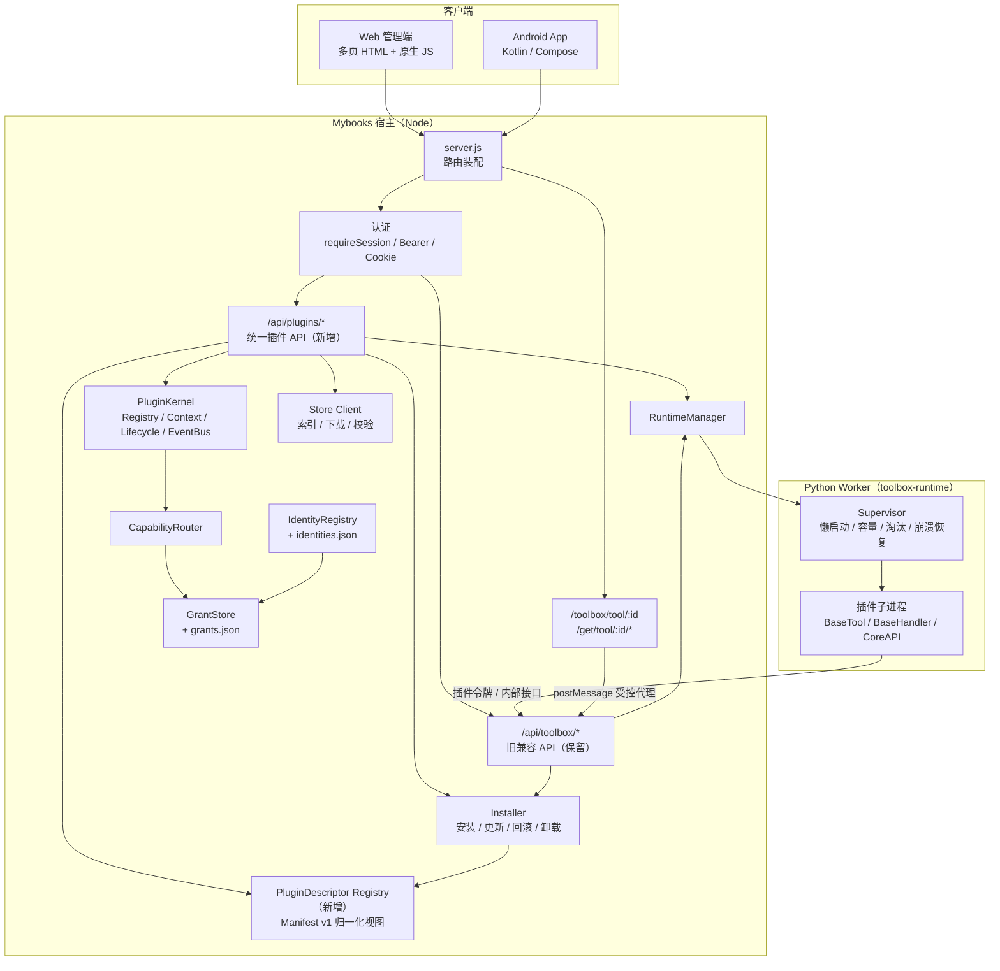
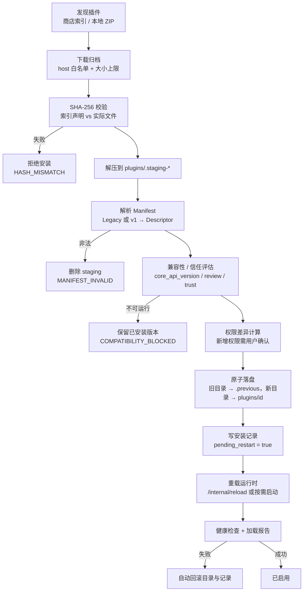
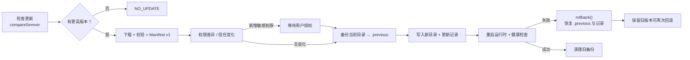
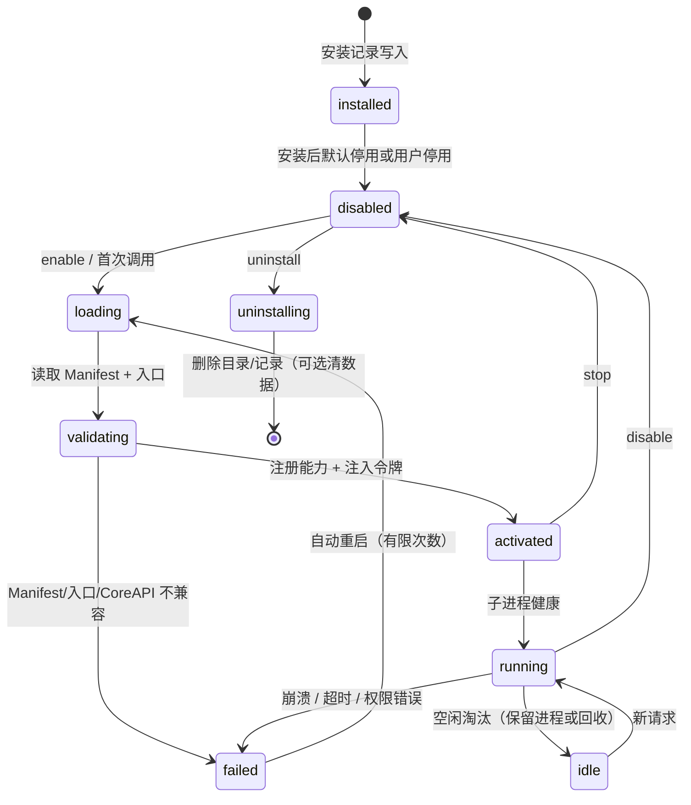
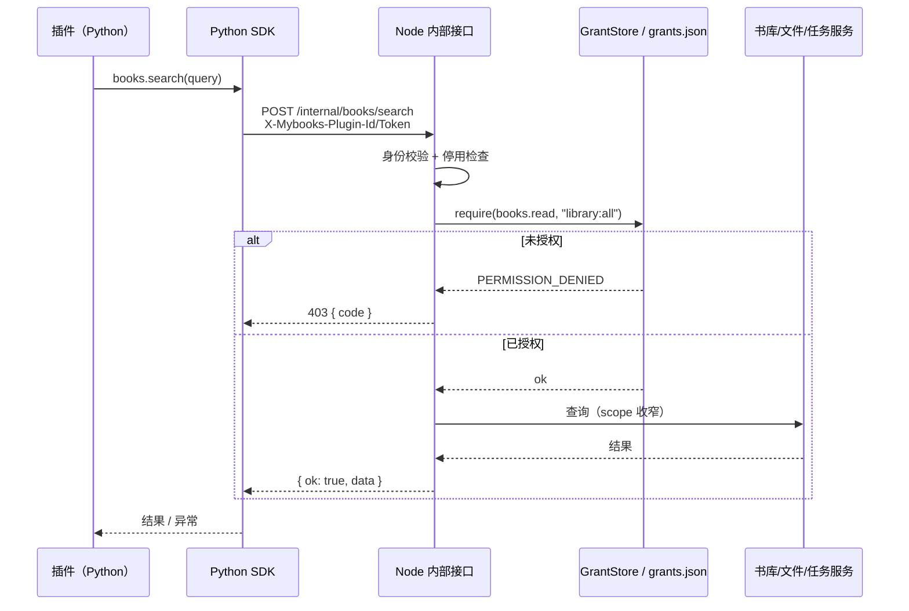
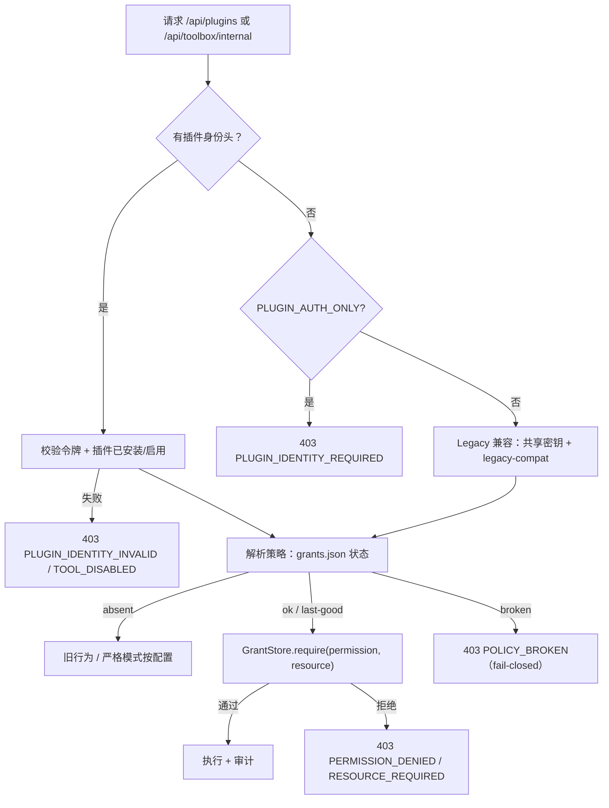
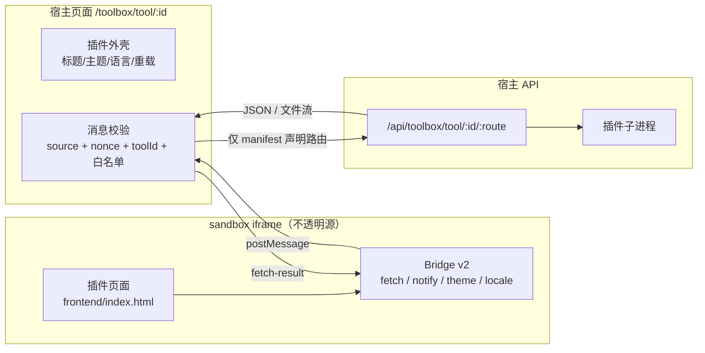

# Phase 4 总体架构

> 基线 `5f52290c` · 只描述设计，不代表已实现
> 状态：✅ 已有 ｜ ◐ 有基础需完善 ｜ ○ Phase 4 新增 ｜ ⏳ 未来阶段

## 1. 现有代码审查结果

### 1.1 分层现状

```text
server.js                      仅装配：认证 → 公开 API → 内部 API → 页面守卫 → /api 会话 → 路由
src/core/plugins/              Plugin Kernel、Capability Router、Runtime Manager、内置 Provider
src/core/toolbox/              旧 Toolbox：安装器、商店、manifest、grants、身份、导入、任务
src/http/                      HTTP 适配：routes.plugins / routes.toolbox* / plugin-services
toolbox-runtime/               Python Worker：runtime.py、supervisor、BaseTool/BaseHandler/CoreAPI
public/                        Web 管理端（多页 HTML + 原生 JS）、插件 sandbox iframe 宿主页
docs/plugins/                  架构、规范、隔离设计与验收状态
```

### 1.2 模块审查表

| 模块 | 现有实现 | 存在的问题 | Phase 4 改造 |
| --- | --- | --- | --- |
| Plugin Kernel | `src/core/plugins/kernel.js`：`define/start/stop/remove/dispose`，持有 Registry/EventBus/GrantStore | 只登记进程内实例；无“已安装插件”统一描述；无依赖解析 | ○ 4A 增加 Manifest→Descriptor 注册视图，Kernel 本身不改接口 |
| Registry | `registry.js`：按 `[capability, version, providerId]` 注册/查询/resolve | 无能力契约强制校验；无 Provider 健康度 | ◐ 4A 注册时校验契约；4B 补健康与降级 |
| Context | `context.js`：WeakMap 私有状态、`permissions.can/require`、`register/on/track/dispose` | 无 `ctx.config`、`ctx.jobs`、`ctx.ui`、`ctx.dependencies` | ○ 4B 以新增方法扩展，不破坏现有公开面 |
| Lifecycle | `lifecycle.js`：幂等 start/stop、失败回滚、`fail()` 撤能力 | 无 install/enable/disable/uninstall 钩子；无健康检查 | ○ 4A 增加生命周期钩子声明；4E 接入真实插件 |
| EventBus | `events.js`：emit/emitAwait、异常隔离、traceId、超时、订阅上限 | 无事件契约与权限门禁 | ○ 4B 增加事件目录与订阅白名单 |
| Identity | `identity.js` + `src/core/toolbox/identities.js` + Python `identity.py`：每插件 48-hex 令牌 | 令牌文件与 Worker 共享卷；Legacy 共享 Worker 下仍可冒用 | ◐ 4A 统一 Descriptor 的 trust 字段；5+ 容器级隔离再收紧 |
| Permissions | `permissions.js`：12 个权限、resource-scoped、GrantStore | 权限目录不可扩展；无审计；`network.*` 未在运行时强制 | ○ 4A 版本化权限目录；4D/4E 追加审计事件 |
| Runtime Manager | `runtime-manager.js`：适配器 `health/start/stop/invoke/cancel/dispose`，未实现显式 `RUNTIME_UNSUPPORTED` | 只有 Legacy Toolbox 适配器；无 JS/外部服务适配器 | ◐ 4B 保持接口不变，新增适配器；不提前抽象 |
| Capability Router | `capability-router.js`：输入校验 → 权限 → Provider → 超时/取消 → 输出校验 | 能力目录只有 `metadata.search@1` | ○ 4B 扩展能力契约目录 |
| Toolbox 安装器 | `src/core/toolbox/installer.js`：staging、`.previous`、原子 rename、DB 失败回滚、`pending_restart` | Manifest 无版本/权限/UI 声明；来源信任只靠 allowlist | ○ 4A 双读 Manifest v1；4C 商店信任分级 |
| 商店 | `store.js`：索引 URL、host 白名单、SHA-256 二次校验、缓存 | 单商店；无分类/详情/更新日志；Store API 只在 `/api/toolbox` 下 | ○ 4C 多来源与只读 `/api/plugins/store/*`，写操作仍走 installer |
| UI 宿主 | `routes.toolbox.ui.js` + `public/toolbox-tool.html` + `page-toolbox-tool.js`：sandbox iframe、nonce、路由白名单 | Bridge 无版本协商；只有整页 iframe；无 Slots/Schema UI；宿主管理页只有工具箱 | ○ 4D Bridge v2 + UI Registry；4C 管理 UI |
| Python Worker | `runtime.py`、`toolbox/plugin_host.py`、`handlers/base.py`、`core_api.py` | 插件协议是隐式约定，无 SDK 包；能力名与 Node 权限未统一映射 | ○ 4B 发布薄封装 SDK，旧 BaseTool 继续可用 |
| 任务 | `src/core/toolbox/tasks.js` + `toolbox_tasks` 表 + supervisor cancel | 无统一 Job ID 语义、无进度事件、无重试策略 | ◐ 4B 统一 Job 视图；不迁移旧表 |
| 产物 | `data/<tool>/work` + 受控权限（2710/2750/0640）+ 现有导入 API | 无 Artifact ID；导入靠文件路径；跨插件不可读但路径耦合 | ○ 4B 增加 Artifact 描述层；导入 API 不改 |
| Android | 文档约定：只消费 Capability/任务/UI 描述，不执行服务端代码 | 本仓库无 Android 源码；无插件 UI 协议 | ○ 4F 只设计协议，客户端改动在独立仓库 |
| 安全 | Phase 3g.1：独立 UID、私有目录、每插件令牌、严格认证 | 网络出口、包签名、审计、UI 隔离仍有缺口 | ○/⏳ 见 [SECURITY.md](SECURITY.md) |

### 1.3 结论

当前代码**具备进入 Phase 4 的条件**：内核、身份、权限、运行时、安装器、Bridge 都有可复用实现。Phase 4 不应新增第二套 Kernel、第二套安装器或第二套权限系统，而应在以下三个接入点扩展：

1. `src/core/plugins/`：新增 Manifest→Descriptor 归一化与能力契约，不改 Kernel 公开接口。
2. `src/core/toolbox/`：`manifest.js`、`installer.js`、`store.js` 做双读与信任分级。
3. `src/http/`：新增 `/api/plugins/*` 只读/管理 API，与 `/api/toolbox/*` 并存；`public/` 新增管理页与 Bridge v2。

---

## 2. 目标架构

### 2.1 系统总体架构



说明：

- `/api/plugins/*` 是 Phase 4 新增的**统一视图与管理面**；所有安装/启停/调用最终仍落到现有 installer、RuntimeManager 与 Toolbox 运行时，避免两套生命周期。
- `PluginDescriptor Registry` 是内存/数据库之上的归一化视图，不替代 `toolbox_tools` 或 Kernel Registry。
- 插件子进程只能通过内部令牌访问 Node 内部接口，不能直接访问 SQLite 或宿主密钥。

### 2.2 模块职责边界

| 层 | 允许做 | 禁止做 |
| --- | --- | --- |
| Store Client | 拉索引、校验 host/SHA-256、缓存、标注审查与兼容性 | 直接改 DB、直接启停子进程、直接执行插件代码 |
| Installer | 解压、校验、原子落盘、备份/回滚、写安装记录 | 执行第三方代码、决定权限 |
| Descriptor Registry | 归一化 Manifest、查询视图、兼容性/信任标注 | 替代 Kernel Registry、绕过 grants |
| PluginKernel | 进程内实例生命周期、能力注册、事件 | 安装包管理、网络下载、UI 渲染 |
| CapabilityRouter | 契约校验、权限门禁、Provider 选择、超时/取消 | 直接写数据库、直接拼 SQL |
| RuntimeManager | 运行时适配、健康、启停、调用、取消 | 解析 Manifest、安装包 |
| Python Worker | 加载插件、执行 handler、调用 CoreAPI | 访问宿主 DB/密钥、绕过内部接口 |
| UI Host | iframe 生命周期、消息校验、路由白名单代理 | 让插件访问宿主 DOM/Cookie |

---

## 3. 插件注册与发现（4A）

### 3.1 统一描述符

新增 `PluginDescriptor`（内存视图 + 可持久化缓存），字段见 [MANIFEST-V1.md](MANIFEST-V1.md#3-归一化描述符)。

来源分三类，最终归一：

1. **已安装**：`toolbox_tools` + `manifest` JSON（旧包为 legacy 形状）。
2. **内置**：Kernel 中 `builtin.*` 实例（如豆瓣/OpenLibrary Provider）。
3. **商店**：`store.js` 索引条目（未安装，仅展示）。

`GET /api/plugins` 从“只读列表”扩展为统一描述符列表，保留现有字段以兼容旧调用方。

### 3.2 双读规则

```text
manifest.json
  ├─ 无 manifest_version → 按 Legacy 解析（现有 parseManifest）
  └─ manifest_version=1  → 按 v1 解析（新增 normalizeManifest）
        └─ 两者都输出同一 PluginDescriptor，安装器与运行时只消费 Descriptor
```

- 未知字段：`x-*` 允许并保留；其他未知字段记录 warning，不参与执行；严格校验模式（商店发布/本地打包）直接拒绝。
- 任何声明的权限都不会自动授予；未声明权限的调用一律 403。

---

## 4. 安装、更新与回滚

### 4.1 安装流程



与现有代码的对应关系：

- 下载/校验：`src/core/toolbox/store.js`（已有）。
- 解压/原子落盘/回滚：`src/core/toolbox/installer.js`（已有）。
- 兼容性：`manifest.js::assessCompatibility`（已有，4A 增加 trust 与 v1 字段）。
- 权限差异：○ 4C 新增（读取 `permissions[]` 与当前 `grants.json`）。

### 4.2 更新与回滚流程



- 回滚实现已存在：`installer.rollback()`（交换目录、更新记录、`pending_restart`）。
- 4A 起回滚必须同时校验旧版本 Manifest 与 UID 数据目录兼容；数据目录不迁移。
- UID 注册表与数据属主在安装/更新/回滚中保持不变（Phase 3g.1 已实现）。

---

## 5. 插件启动与生命周期



要点：

- 启动是**懒启动**：`supervisor.ensure_child` 只在请求或显式 start 时拉起。
- 失败不允许“静默继续”：`failed` 状态必须写 `last_error`，并在 `/api/plugins` 暴露。
- 停用后能力立即从 Registry 摘除；已安装但停用的插件内部接口统一 403 `TOOL_DISABLED`（已有）。

---

## 6. 插件能力调用



宿主内部调用（Provider 之间）继续走 `CapabilityRouter.invoke`：

```text
契约校验 → principal 权限 → 选择 Provider → 超时/取消 → 输出校验 → 返回
```

两条路径的权限判定都落到同一个 `GrantStore`，不允许 SDK 自行判断权限。

---

## 7. 权限验证



权限目录与分类见 [SECURITY.md](SECURITY.md#3-权限体系)。关键约束：

- Manifest 只声明“需要什么”，授权来自用户/管理员；
- 资源型权限必须显式 `resource`（现有 `require()` 行为）；
- 新增权限必须版本化，旧宿主遇到未知权限时拒绝该插件进入严格模式，而不是忽略。

---

## 8. 运行时架构

| Runtime | 适用场景 | 现状 | Phase 4 计划 |
| --- | --- | --- | --- |
| Python 子进程 | 现有工具箱插件、转换、抓取、入库 | ✅ `supervisor.py` + `runtime.py` | ◐ 4B 统一 Job/SDK；4E 迁移真实插件 |
| JavaScript | 轻量转换、Web 前端逻辑、未来 Node 插件 | ○ 未实现 | ○ 4B 只定义契约；4F 后再评估实现 |
| 外部服务 Adapter | OPDS/WebDAV/自建服务 | ○ 未实现 | ○ 4B 定义 `RuntimeAdapter` 形状，不写死 HTTP |
| 独立容器 | 不可信第三方插件 | ⏳ 未实现 | ⏳ Phase 5+（方案 D） |

统一要求（不因新增 Runtime 改变）：

1. 生命周期：install → enable → start → invoke → stop → disable → uninstall。
2. 权限：一律经 Node 授权，Runtime 不自带权限系统。
3. 任务：统一 Job 视图，Python 的 `toolbox_tasks` 作为第一实现。
4. 错误码：`RUNTIME_*`、`CAPABILITY_*`、`PERMISSION_*`、`VALIDATION`。
5. 日志：结构化字段 `plugin_id/task_id/route/level`，不输出密钥。
6. 崩溃恢复：supervisor 重启 + 有限重试；任务标记失败而不是永久 running。
7. 超时/取消：HTTP 超时 + `AbortSignal` + 插件 cancel 路由，三者语义分离。
8. 资源限制：当前 `RLIMIT_AS`/文件描述符；CPU/磁盘在容器级阶段补齐。
9. 更新/回滚：由 installer 统一完成，Runtime 只负责重载与健康检查。

---

## 9. 任务与产物

- **任务**：继续使用 `toolbox_tasks` + `/api/toolbox/tasks*`；新增 `/api/plugins/:id/jobs` 作为统一视图（读同一数据，不复制表）。Job 字段：`job_id/plugin_id/status/stage/progress/created_at/finished_at/error/result`。
- **产物**：继续使用 `data/<tool_id>/work` 与现有导入 API；新增 **Artifact 描述层**（`artifact_id` → 路径/大小/SHA-256/所属任务/过期时间），只用于下载与 UI 展示，不改变 `import` 入参。
- **一致性**：文件落盘成功但 DB 失败时补偿删除；导入保持幂等键；不把“转换成功”等同于“入库成功”。

---

## 10. UI 与跨端（摘要）

完整方案见 [UI-ARCHITECTURE.md](UI-ARCHITECTURE.md)。



- 宿主管理 UI（商店/已安装/详情/权限/配置/日志）由 Mybooks 自己实现，复用 `public/css/style.css`、`liquid-glass.css`、`toolbox.css` 的变量与组件。
- 插件 UI 继续 sandbox iframe，**不启用 `allow-same-origin`**；Bridge v2 只做加法并保留 v1 行为。
- Android：简单配置/操作使用 Schema UI；复杂页面使用受限 WebView + 一次性 UI 会话令牌；不加载 APK。

---

## 11. 代码接入点（不重写现有模块）

| 新增内容 | 接入位置 | 说明 |
| --- | --- | --- |
| Manifest v1 解析 | `src/core/toolbox/manifest.js` 旁新增 `manifest-v1.js` | 现有 `parseManifest` 保持不变，供旧包使用 |
| Descriptor Registry | `src/core/plugins/descriptor.js` | 只读归一化，不放进 Kernel |
| `/api/plugins` 管理 API | `src/http/routes.plugins.admin.js` | 复用 `requireSession`；server.js 在 `/api` 守卫后挂载 |
| 商店只读 API | 扩展 `src/http/routes.plugins.js` | 内部委托 `store.js`，写操作仍走 `/api/toolbox/*` |
| Python SDK | `plugin-sdk/python/` | 薄封装现有 `CoreAPI`，不改 Worker 协议 |
| 前端 SDK | `public/static/plugin-sdk/v1.js` | 在现有 `toolbox-bridge.js` 之上提供版本协商与 Schema 渲染 |
| UI Registry | `src/core/plugins/ui-registry.js` | 记录可用 Slots/Pages，不注入宿主 DOM |
| 审计 | `src/core/plugins/audit.js` + `state/audit.jsonl` | 追加写，失败不阻断主流程 |
| Android 协议 | 仅文档与 `/api/plugins/*` 字段 | 客户端仓库独立实施 |

---

## 12. 架构决策记录（ADR 摘要）

| ID | 决策 | 理由 | 后果 |
| --- | --- | --- | --- |
| ADR-1 | Manifest v1 是旧格式超集 | 旧插件零改造继续运行 | 解析器需双读；字段映射必须测试 |
| ADR-2 | 不新建第二套插件注册表 | 避免与 `toolbox_tools`/Kernel 冲突 | Descriptor 只是视图；写操作仍走 installer |
| ADR-3 | UI 继续 sandbox iframe | 已被真实插件验证；改造成本最低 | 复杂布局/高度自适应需 Bridge 增强 |
| ADR-4 | 第三方插件不启用 `allow-same-origin` | 防止读取宿主 Cookie/DOM | 插件必须通过 Bridge 访问 API |
| ADR-5 | 插件权限声明不自动授予 | 遵循现有 fail-closed 原则 | 新增权限必须用户确认，更新时重新确认 |
| ADR-6 | 商店与运行时解耦 | 供应链与执行边界分离 | 商店故障不影响已安装插件运行 |
| ADR-7 | Android 只消费协议，不执行插件代码 | 平台安全与审核约束 | Phase 4F 只做协议协商与受限 WebView |
| ADR-8 | 网络出口、CPU/磁盘配额延后 | 需要容器/网络策略，非本轮 | 不得在文档或 UI 宣称已隔离 |
