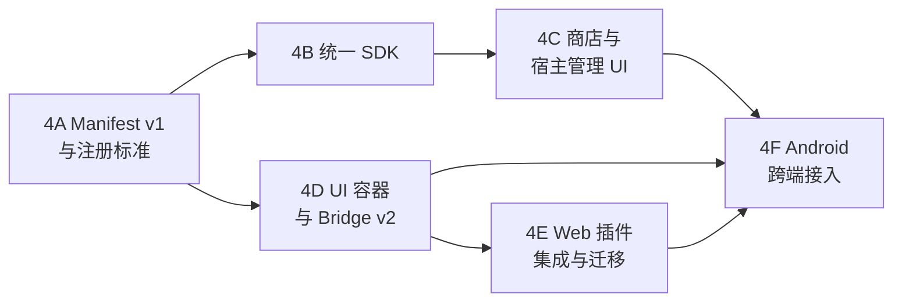

# Phase 4 开发路线与验收标准

> 状态：○ 规划。阶段顺序按依赖排列，不要求一次性发布。
> 每个子阶段都必须独立可回滚，且不破坏 Phase 3g.1 已验证能力。

## 0. 依赖关系



- 4B 与 4D 可并行，但都必须以 4A 的 Descriptor 为准。
- 4C 依赖 4B 的 Job/Artifact 视图（只读展示）。
- 4F 只定义协议与宿主改动，Android 客户端在独立仓库实施。

---

## 4A：Manifest v1 与插件注册标准

> 状态：✅ 已实施（2026-11-09）。实施结果见本节末尾与 [MANIFEST-V1.md](MANIFEST-V1.md#10-phase-4a-实施状态)。

### 1. 开发目标

- 引入 `manifest_version: 1`，双读新旧 Manifest，输出统一 `PluginDescriptor`。
- 建立权限/配置/UI/依赖/事件的声明结构，但不改变现有授权与运行行为。
- 新增只读描述符 API，保留 `GET /api/plugins` 原有契约不变。

### 2. 涉及模块

`src/core/toolbox/manifest.js`、`installer.js`、`store.js`、`src/core/plugins/`、`src/http/routes.plugins.js`、`src/db/toolbox.js`。

### 3. 现有代码位置

- 解析：`src/core/toolbox/manifest.js::parseManifest`
- 安装：`src/core/toolbox/installer.js::installPrepared`
- 只读 API：`src/http/routes.plugins.js`
- 数据：`src/db/toolbox.js`（`toolbox_tools`）

### 4. 新增代码位置

```text
src/core/toolbox/manifest-v1.js      # 解析/严格校验/字段映射（已实施）
src/core/toolbox/descriptor.js       # Descriptor 归一化与查询视图（已实施）
test/plugin-descriptor.test.js       # 29 项测试（已实施）
```

### 5. API 设计

```http
GET /api/plugins                    # 保持既有契约（LegacyToolboxAdapter）
GET /api/plugins/descriptors
→ { manifest_mode: "auto", plugins: [PluginDescriptor] }

GET /api/plugins/:id/descriptor
→ { manifest_mode: "auto", plugin: PluginDescriptor } 或 404
```

`PluginDescriptor` 已删除 `raw` 字段，不返回绝对路径。

### 6. 数据结构

```json
{
  "id": "md_to_epub",
  "version": "1.2.0",
  "manifest_version": 1,
  "source": "store",
  "trust": "reviewed",
  "runtime": { "type": "python" },
  "permissions": [],
  "compatibility": { "supported": true, "reasons": [] },
  "legacy": false
}
```

不新增表；`manifest` 列继续存原始 JSON。

### 7. 前端页面

无新增页面；4C 的详情页消费该 API。

### 8. 安全要求

- 未知字段：`x-*` 允许；其他忽略 + warning；严格校验拒绝。
- 权限声明不产生授权。
- `trust` 由宿主计算，Manifest 自报无效。
- 解析失败不得影响已安装版本运行。

### 9. 测试方案

| 层级 | 用例 |
| --- | --- |
| 单元 | Legacy/v1 双读、字段映射、未知字段、权限 scope、路由重复、依赖成环 |
| 集成 | 用 zlibrary/md_to_epub 真实包安装，检查 Descriptor |
| 兼容 | 现有 `parseManifest` 测试全部保持通过 |
| 安全 | 伪造 `manifest_version`、超长字段、路径穿越 |

### 10. 验收标准

1. 无 `manifest_version` 的旧包行为与 Phase 3g.1 完全一致。
2. v1 包可安装/启用/调用/回滚。
3. `/api/plugins/descriptors` 同时返回 Legacy 与 v1 描述符，字段稳定；`/api/plugins` 契约不变。
4. 严格校验能拒绝未知权限与非法 Slot。
5. 无数据库迁移要求。

### 11. 兼容风险

解析器分叉导致行为差异；旧字段与新字段冲突。

**缓解**：统一 Descriptor 契约测试；冲突字段以 Legacy 为准并记录 warning。

### 12. 实施结果（Phase 4A）

| 项 | 结果 |
| --- | --- |
| Legacy 兼容 | 全部旧包继续使用 `parseManifest` 字段；Node 全量测试通过 |
| v1 解析 | `manifest_version: 1`、字段校验、长度/数量上限、路径穿越防护 |
| 统一 Descriptor | `src/core/toolbox/descriptor.js`，深冻结只读，Legacy 与 v1 同一结构 |
| 环境开关 | `auto` / `off` / `strict`；`off` 明确拒绝 v1 安装，不静默降级 |
| 安装门禁 | required 依赖缺失、UI 入口缺失、后端模块缺失均在落盘前拒绝 |
| 权限 | 只声明；未知权限（含 `jobs.read`/`events.subscribe`）直接拒绝，不产生 grants |
| 测试 | `npm test` 799/799；新增 29 项 Descriptor/Manifest 测试 |
| 未实施 | `manifest.sig` 验签、生命周期执行、事件投递、Slot 渲染 |

### 13. 回滚方案

`MYBOOKS_PLUGIN_MANIFEST_V1=off` 后重启 Node：新 v1 安装被明确拒绝，已安装 v1 包仍按 v1 只读识别（不降级为 Legacy）；安装目录与数据不变。

---

## 4B：统一 Plugin SDK

### 1. 开发目标

- 发布 Python SDK 薄封装，覆盖书籍/文件/任务/配置/元数据/事件。
- 新增前端 SDK（基于现有 Bridge），统一能力名与错误码。
- 补内部接口：`jobs.get/result`、`books.create/update/reading-status`、`files.publish/metadata`、`config.validate`。

### 2. 涉及模块

`toolbox-runtime/webserver/toolbox/core_api.py`、`node_client.py`、`src/http/routes.toolbox.internal.js`、`src/core/toolbox/tasks.js`、`src/core/toolbox/import.js`、`public/static/`。

### 3. 现有代码位置

- CoreAPI：`toolbox-runtime/webserver/toolbox/core_api.py`
- NodeClient：`toolbox-runtime/webserver/toolbox/node_client.py`
- 内部接口：`src/http/routes.toolbox.internal.js`
- 任务：`src/core/toolbox/tasks.js`、`src/db/toolbox.js`
- Bridge：`public/static/toolbox-bridge.js`

### 4. 新增代码位置

```text
plugin-sdk/python/mybooks_plugin_sdk/   # 包与测试
public/static/plugin-sdk/v1.js           # 前端 SDK
src/http/routes.plugins.internal.js      # 新增内部能力端点（若需要拆分）
test/plugins-sdk-contract.test.js
toolbox-runtime/tests/test_sdk.py
```

### 5. API 设计

内部接口（示例）：

```http
POST /internal/toolbox/books
PATCH /internal/toolbox/books/:id
GET  /internal/toolbox/books/:id/reading

POST /internal/toolbox/artifacts
GET  /internal/toolbox/artifacts/:id
GET  /internal/toolbox/tasks/:id
GET  /internal/toolbox/tasks/:id/result
POST /internal/toolbox/config/validate
```

全部要求插件身份头；错误格式 `{ code, message }` 与现有 `err/msg` 兼容。

### 6. 数据结构

- Job 视图：`job_id, plugin_id, status, stage, progress, created_at, finished_at, error, result`。
- Artifact：`artifact_id, plugin_id, job_id, path, format, size, sha256, expires_at`（路径不对外）。
- 配置：继续 AES-256-GCM；`x-sensitive` 字段读取返回掩码。

### 7. 前端页面

无新增页面；提供 SDK 文档与示例。

### 8. 安全要求

- 所有方法在 Node 侧做权限判断；SDK 不自带授权。
- 不返回绝对路径、内部密钥、原始堆栈。
- 产物登记校验格式/大小/SHA-256，拒绝路径穿越。
- 任务归属校验：插件只能查/取消自己的任务。

### 9. 测试方案

- 契约测试：Python/前端共用 JSON 向量。
- 权限测试：未授权 → 403，错误码不被改写。
- 兼容测试：旧 BaseTool + CoreAPI 行为不变。
- 真实插件：md_to_epub 全链路；zlibrary 任务/取消。

### 10. 验收标准

1. 旧插件不修改代码即可继续运行。
2. 新 SDK 示例可完成“创建任务 → 进度 → 发布产物 → 导入 → 完成”。
3. 所有新增内部接口都有权限与归属测试。
4. SDK 包可在 Worker 镜像中导入，无额外运行时依赖。

### 11. 兼容风险

SDK 抽象过度、与现有 CoreAPI 重复。

**缓解**：只封装现有调用，不新增状态；旧 API 保持可用。

### 12. 回滚方案

SDK 是可选依赖；旧插件移除 import 即可恢复 CoreAPI 调用。内部新增接口保持向后兼容，不做删除。

---

## 4C：插件商店与宿主管理 UI

### 1. 开发目标

- 统一插件商店（分类/搜索/详情/版本/权限/更新日志）与已安装管理。
- 新增 `/api/plugins/*` 只读与管理 API；写操作仍委托 `/api/toolbox/*`。
- 复用现有设计体系，提供权限授权、配置、运行状态、日志页面。

### 2. 涉及模块

`src/core/toolbox/store.js`、`installer.js`、`plugin-grants.js`、`src/http/routes.plugins.js`、`public/`。

### 3. 现有代码位置

- 商店：`src/core/toolbox/store.js`（`STORE_URL`、`normalizeEntry`、`downloadArchive`）
- 安装：`src/http/routes.toolbox.js`
- 页面：`public/toolbox.html`、`public/js/page-toolbox.js`、`public/css/toolbox.css`

### 4. 新增代码位置

```text
src/http/routes.plugins.admin.js
src/core/plugins/audit.js
public/plugins.html
public/js/page-plugins.js
public/js/page-plugin-detail.js
public/css/plugins.css            # 只补充布局，视觉复用 toolbox.css
test/plugins-admin-api.test.js
```

### 5. API 设计

```http
GET  /api/plugins/store/index?q=&category=&sort=
GET  /api/plugins/store/:id
GET  /api/plugins/:id/versions
GET  /api/plugins/:id/permissions
PUT  /api/plugins/:id/permissions
GET  /api/plugins/:id/logs?limit=&before=
POST /api/plugins/:id/install      → 委托 installer
POST /api/plugins/:id/update       → 委托 installer
POST /api/plugins/:id/rollback     → 委托 installer
DELETE /api/plugins/:id?purge_data=
POST /api/plugins/:id/enable|disable
```

- 所有写接口要求会话 + 管理员权限（现有 `requireSession`；如需管理员再叠加 `requireAdmin`）。
- 写接口只做参数校验与委托，不复制安装逻辑。

### 6. 数据结构

- 商店条目：现有 `normalizeEntry` + `categories/tags/changelog/trust`。
- 授权：`grants.json` 现有格式 + 审计事件。
- 日志：结构化 JSONL，脱敏后分页返回。

### 7. 前端页面

`/plugins`：商店/已安装/任务三个 tab；`/plugins/:id`：详情、权限、配置、版本、日志。
复用 `.tb-page`、`.tb-hero`、`.topbar`、控件 token、Lucide sprite。

### 8. 安全要求

- 不展示绝对路径、密钥、原始堆栈。
- 权限差异必须显式展示；新增权限默认不勾选。
- 所有状态变更写审计。
- 日志接口做注入/转义与分页限制。

### 9. 测试方案

- API 单元/集成：安装/更新/回滚/卸载委托、权限差异、日志分页。
- 浏览器验收（真实登录）：商店搜索、安装、详情、授权、停用、回滚。
- 安全：越权写接口、路径参数、超大分页。

### 10. 验收标准

1. 商店可搜索/分类/查看详情并安装真实插件。
2. 已安装页状态与 `toolbox_tools` 一致（启用/停用/待重启/错误）。
3. 权限页可授权/撤销，立即生效。
4. 更新/回滚/卸载全部复用既有安装器，无第二套逻辑。
5. 移动端布局不破版（现有管理页断点）。

### 11. 兼容风险

新页面与旧 `/toolbox` 功能重复、状态不同步。

**缓解**：只读数据同源；写操作全部委托；旧页面保留到 4E 结束。

### 12. 回滚方案

删除/隐藏新导航入口即可回到 `/toolbox`；后端新增路由为附加，不影响旧接口。

---

## 4D：插件 UI 容器与通信协议

### 1. 开发目标

- 建立 UI Registry（Pages/Slots），Bridge v2 版本协商，Schema UI 渲染器。
- 保持 sandbox iframe 与现有 CSP；新增资源必须白名单。
- 提供加载失败、卸载、主题/语言、下载与打开书籍的统一处理。

### 2. 涉及模块

`src/http/routes.toolbox.ui.js`、`public/toolbox-tool.html`、`public/js/page-toolbox-tool.js`、`public/static/toolbox-bridge.js`、新增 `ui-registry`。

### 3. 现有代码位置

- 宿主页：`public/js/page-toolbox-tool.js`（nonce、消息校验、下载）
- Bridge：`public/static/toolbox-bridge.js`
- CSP：`src/http/routes.toolbox.ui.js::pluginCsp`
- 页面：`public/toolbox-tool.html`（sandbox iframe）

### 4. 新增代码位置

```text
src/core/plugins/ui-registry.js
src/http/routes.plugins.ui.js
public/static/plugin-sdk/v1.js
public/js/ui-schema.js
test/plugin-ui-protocol.test.js
```

### 5. API 设计

```http
GET /api/plugins/:id/ui
→ { protocol, pages, slots, schema, capabilities }
```

消息协议见 [UI-ARCHITECTURE.md](UI-ARCHITECTURE.md#5-bridge-协议)。

### 6. 数据结构

```json
{
  "protocol": 2,
  "pages": [{ "id": "main", "title": "…", "slot": "toolbox.tool", "entry": "index.html" }],
  "slots": [{ "id": "…", "slot": "book.detail.actions", "schema": {} }]
}
```

### 7. 前端页面

- 升级 `/toolbox/tool/:id` 外壳：协议协商、错误态、重载、主题/语言同步。
- 新增 Schema 表单渲染器（原生 JS，无框架）。
- 管理端 Slot 容器（书详情/设置）在 4E 按需接入。

### 8. 安全要求

- iframe 不启用 `allow-same-origin`；CSP 不含 `*`。
- 严格校验 source/nonce/toolId/type/route/method/size。
- 未知消息忽略；未知 Slot 降级。
- 插件不能直接访问宿主 DOM、Cookie、内部 API。

### 9. 测试方案

- 单元：消息校验矩阵（伪造 source/nonce/toolId、超长、未声明路由）。
- 集成：Bridge v1 插件在 v2 宿主回归。
- 浏览器：iframe 加载、超时、重载、下载、打开书籍、主题/语言切换。
- 安全：CSP 报告、iframe 读取 Cookie 失败。

### 10. 验收标准

1. v1 与 v2 插件同一宿主可用。
2. 非白名单请求全部拒绝且有稳定错误提示。
3. 加载失败不白屏，提供重载。
4. Schema UI 字段类型/校验/错误展示与规范一致。

### 11. 兼容风险

Bridge 语义变化导致旧插件失败；CSP 收紧导致资源加载失败。

**缓解**：v2 只做加法；CSP 变更需对两个真实插件回归；保留 v1 脚本路径。

### 12. 回滚方案

`MYBOOKS_PLUGIN_UI_PROTOCOL=1` 强制 v1 行为；前端资源保持旧版路径；iframe 容器不变。

---

## 4E：Web 插件集成与迁移

### 1. 开发目标

- 将 md_to_epub、zlibrary 迁移到 Manifest v1，并接入统一管理 UI。
- 真实浏览器验收：安装、授权、配置、转换/搜索、下载/入库、停用、更新、回滚。

### 2. 涉及模块

插件包（外部仓库）、allowlist、商店索引、`/api/plugins/*`、`public/`。

### 3. 现有代码位置

- allowlist：`src/core/toolbox/allowlist.js`
- 商店索引：由 `MYBOOKS_TOOLBOX_STORE_URL` 指向
- 真实插件包：zlibrary@0.1.0、md_to_epub@1.1.0（Phase 3g 验证）

### 4. 新增代码位置

- 插件仓库更新 `manifest.json`（v1）与前端适配（Bridge v2）。
- 本仓库仅更新 allowlist/测试夹具与文档。

### 5. API 设计

复用 4C/4D，不新增协议；如需兼容字段，按“只加不改”。

### 6. 数据结构

无新表；安装记录中的 `manifest` 变为 v1 JSON，`compatibility` 保持。

### 7. 前端页面

插件页面由插件提供；宿主提供外壳、权限、配置、任务视图。

### 8. 安全要求

- 迁移不扩大权限；新增权限重新授权。
- 保留旧版本安装包作为回滚点。
- 真实插件必须走 `PLUGIN_AUTH_ONLY` 与独立 UID 验收。

### 9. 测试方案

- Docker 双容器真实插件：安装 → 授权 → 转换/搜索 → 入库 → 重启 → 回滚。
- 浏览器：登录态下商店/详情/插件页/下载。
- 兼容：Bridge v1 前端在 v2 宿主回归。

### 10. 验收标准

1. md_to_epub：上传 Markdown + 图片 → EPUB → 下载 → 入库 `book_id`。
2. zlibrary：配置保存、搜索、任务进度、取消、下载（外网不可用时明确报错）。
3. 停用后入口消失、内部接口 403；启用后恢复。
4. 更新/回滚后数据与配置不丢失。
5. UI 浏览器验收通过（至少 Chromium）。

### 11. 兼容风险

外部插件不能及时升级；迁移期间新旧版本并存。

**缓解**：宿主双读；旧版本继续可用；按插件灰度。

### 12. 回滚方案

单插件回滚到旧包（installer.rollback）；宿主侧保留旧 `toolbox` 页面与 Bridge v1。

---

## 4F：Android 跨端接入

### 1. 开发目标

- 定义 Android 消费的插件协议：Descriptor、UI 声明、任务、权限。
- 简单页面用 Schema UI，复杂页面用受限 WebView；不加载 APK/原生代码。
- 服务端改动保持“只加字段”，旧客户端忽略未知字段。

### 2. 涉及模块

`/api/plugins/*` DTO、`/api/plugins/:id/ui`、一次性 UI 会话、文档。

### 3. 现有代码位置

- `src/http/routes.plugins.js`（只读）
- `src/http/middleware.auth.js`（会话/Bearer）
- `docs/SYNC_PROTOCOL.md`（Android 同步协议，不得破坏）

### 4. 新增代码位置

```text
src/http/routes.plugins.mobile.js   # 移动端专用 DTO/UI 会话
docs/plugins/phase4/ANDROID.md      # 客户端实施说明（后续）
```

Android 客户端改动在独立仓库，本仓库不包含 Kotlin 代码。

### 5. API 设计

```http
GET  /api/plugins                    # 已有，新增字段向后兼容
GET  /api/plugins/:id/ui             # pages + schema + capabilities
POST /api/plugins/:id/ui-session     # 短时效、绑定 user/plugin
GET  /api/plugins/:id/jobs           # 任务列表（只读）
```

### 6. 数据结构

`UiDescriptor`：`protocol/pages/slots/schema/capabilities`；未知字段客户端必须忽略。

### 7. 前端页面

Android 原生页面（Compose）或 WebView；本仓库只提供 Web 资源与协议。

### 8. 安全要求

- WebView 关闭文件访问、禁止任意 JS 桥；只暴露最小消息集合。
- 一次性 `ui_session` 不携带管理员 Token，不写入长期存储。
- 权限由宿主决定；客户端不缓存旧权限。

### 9. 测试方案

- 契约测试：DTO/字段兼容、未知字段忽略。
- Mock 客户端：Schema 渲染、任务轮询、WebView 会话。
- 真实 Android 验收在独立仓库执行；未完成前标记“未验证”。

### 10. 验收标准

1. 旧 Android 客户端在新增字段后不崩溃、不误解权限。
2. Schema 页面在 Web 与 Android 渲染一致。
3. WebView 不持有管理员 Token，下载/打开书籍经宿主代理。
4. 插件停用/卸载后客户端下次进入不展示旧入口。

### 11. 兼容风险

客户端版本碎片化；WebView 安全配置错误。

**缓解**：协议只加字段；服务端 capability 协商；端上禁用危险 WebView 设置。

### 12. 回滚方案

服务端删除/隐藏移动端专用路由即可；旧客户端继续使用现有 API；不影响 Web。

---

## 整体验收（Phase 4 DoD）

1. **Manifest**：旧包与 v1 包并存；严格校验可拒绝非法声明。
2. **SDK**：旧插件零改造运行；新 SDK 覆盖六类能力；权限在后端强制。
3. **商店/管理**：真实安装/更新/回滚/卸载；权限可视化与撤销；日志脱敏。
4. **UI**：Bridge v1/v2 共存；消息伪造全部拒绝；加载失败可恢复。
5. **迁移**：md_to_epub、zlibrary 完成 v1；回滚路径可用。
6. **Android**：协议字段稳定；WebView 不持有管理员 Token；真实客户端验收单独记录。
7. **安全**：Phase 3g.1 的 UID/权限/隔离测试全部保持通过；不新增“未验证即宣称已实现”的条目。
8. **测试**：Node/Python 全套通过；Docker 双容器真实插件回归；浏览器至少 Chromium 验收。

## 明确不在 Phase 4 开发

| 项 | 原因 | 归属 |
| --- | --- | --- |
| 容器级恶意代码沙箱 | 需要编排/网络/内核能力 | Phase 5+ |
| 网络出口白名单 | 同上 | Phase 5+ |
| CPU/磁盘 cgroup 配额 | 同上 | Phase 5+ |
| 第三方原生 Android 插件 | 平台安全与审核 | 不计划 |
| 插件市场付费/评分 | 与平台核心无关 | 后续产品阶段 |
| 重写 Plugin Kernel / Runtime Manager / 安装器 | 违反兼容约束 | 不做 |
