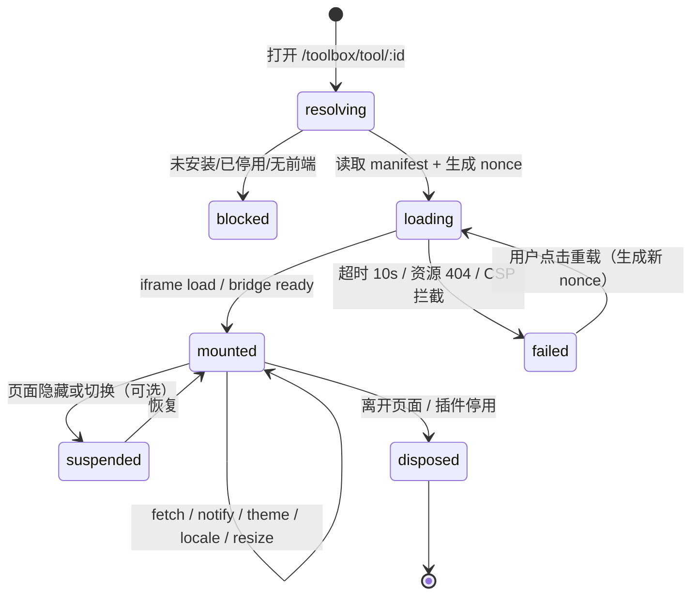
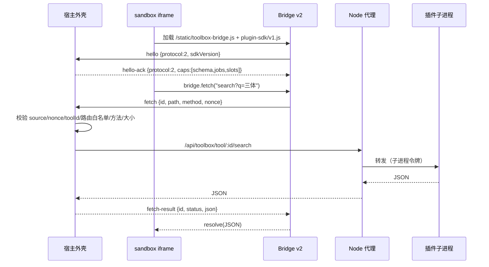

# 插件 UI 架构与通信协议

> 状态：宿主管理 UI ○ 4C；Bridge v2 / Slots ○ 4D；Web 集成 ○ 4E；Android ○ 4F
> 现有实现：sandbox iframe + `postMessage` + 路由白名单（Phase 3g 已验证）

## 1. 两部分 UI

### 1.1 宿主插件管理 UI（Mybooks 自己实现）

| 页面 | 路由（规划） | 数据来源 | 现状 |
| --- | --- | --- | --- |
| 插件商店 | `/plugins`（或 `/toolbox?tab=store`） | `GET /api/plugins/store/index` | ◐ 现有 `toolbox.html` 商店 tab |
| 已安装 | `/plugins/installed` | `GET /api/plugins` | ◐ 现有工具箱列表 |
| 插件详情 | `/plugins/:id` | `GET /api/plugins/:id` | ○ 4C |
| 权限与授权 | `/plugins/:id/permissions` | `GET/PUT /api/plugins/:id/grants` | ○ 4C |
| 配置 | `/plugins/:id/config` | `GET/PUT /api/plugins/:id/config` | ◐ 插件自绘配置 |
| 运行状态 | `/plugins/runtime` | `GET /api/plugins/runtime` | ✅ 只读健康 |
| 日志 | `/plugins/:id/logs` | `GET /api/plugins/:id/logs` | ○ 4C（脱敏、分页） |
| 更新/回滚 | `/plugins/:id/versions` | `/api/toolbox/:id/update|rollback` | ✅ 后端已有 |

布局与交互规范（必须复用，不新造视觉）：

- 画布与表面：`--paper` / `--card` / `--surface`；发丝线 `--hairline`；唯一交互色 `--accent`（Action Blue）；圆角 `--radius-sm/md/lg`。
- 页面外壳：`.tb-page`、`.tb-hero`、`.tb-eyebrow`、`.tb-title`、`.tb-lede`、`.tb-runtime-box`（现有 `public/css/toolbox.css`）。
- 顶栏：复用 `.topbar` / `.topbar-inner`（`style.css`），不新建导航。
- 弹窗：复用 `modal.js` + `--shadow-pop`；按钮/下拉复用控件 token（`--control-*`）。
- 图标：只使用 `public/vendor/lucide-sprite.svg` 中已存在的图标；新增图标走 `scripts/lucide-icons.json` 与 `npm run check:icons`。
- 图表/进度：使用现有 CSS 变量绘制，不引入大型图表框架。

交互要求：

1. 安装/更新/回滚/卸载必须有进行中、成功、失败三态，并展示稳定错误码。
2. 权限页展示“声明范围 vs 实际授权”，新增权限用差异高亮。
3. 日志页只显示脱敏后的结构化日志，禁止展示内部密钥/绝对路径。
4. 停用插件后其页面入口立即隐藏或置灰，不保留可操作按钮。

### 1.2 插件自定义 UI

插件通过 `frontend.entry` 提供 HTML/CSS/JS，由宿主在受控容器中加载。Phase 4 支持两种形态：

1. **整页工具页**（现有）：`slot: toolbox.tool` → `/toolbox/tool/:id` → sandbox iframe。
2. **Schema UI / Slots**（4D）：宿主用原生组件渲染声明式表单、按钮、任务状态；插件不提供 HTML。

## 2. 容器方案比较

| 方案 | 安全性 | 兼容性 | 开发成本 | 性能 | 跨端 | 结论 |
| --- | --- | --- | --- | --- | --- | --- |
| **sandbox iframe（现状）** | 高：不透明源、无 Cookie/DOM；依赖 CSP + nonce + 路由白名单 | 高：现有插件零改造 | 低：已实现 | 中：独立文档上下文 | Web 直接复用；Android 需 WebView | **Phase 4 默认方案** |
| 独立 Origin | 更高：可设独立 CSP/存储分区 | 中：需要额外域名/证书/反代 | 中高 | 中 | Web 可用；Android WebView 可加载 | ⏳ 后续可选增强，不作为 4D 前置 |
| Web Components / Shadow DOM | 低：同一 JS 上下文，可访问宿主 API/CSS 泄露 | 中 | 中 | 高 | 差：Android 不直接支持 | 不用于第三方插件；仅宿主内部组件 |
| 受控 WebView（Android） | 中：需关闭文件访问/JS 桥白名单 | 高：复用 Web UI | 中 | 中 | Android 原生支持 | 复杂页面方案 |
| 宿主原生组件渲染（Schema UI） | 最高：插件不执行 UI 代码 | 中：受控件类型限制 | 中 | 高 | Web/Android 共用描述 | 简单配置/操作首选 |

**结论**：不把 iframe 当作“绝对安全”，它只是当前成本最低的进程外 UI 边界；真正的恶意代码隔离仍需容器级方案（Phase 5+）。Phase 4 采用：

```text
简单配置/操作 → Schema UI（宿主原生渲染，Web/Android 一致）
复杂交互页面 → sandbox iframe（Web）/ 受限 WebView（Android）
```

## 3. Web 插件 UI 生命周期



规则：

- 每次重载生成新 `nonce`；旧 nonce 的消息一律丢弃。
- 加载失败必须展示原因（未启用、无前端、超时、资源 404），并提供“重载/返回工具箱”。
- 卸载时移除 `message` 监听、取消轮询与下载定时器；宿主不保留插件 DOM。
- 插件停用：宿主关闭 iframe 并清理缓存；再次启用需要重新加载。

## 4. 路由与资源

| 路径 | 作用 | 鉴权 |
| --- | --- | --- |
| `/toolbox/tool/:id` | 插件外壳页（宿主 HTML） | 管理页面守卫（登录） |
| `/get/tool/:id/index.html` | 插件前端入口（重写到 `frontend.entry`） | 允许匿名读取静态资源，但只返回公开前端 |
| `/get/tool/:id/*` | 插件静态资源 | 同上；禁止路径穿越/符号链接 |
| `/get/tool/:id/icon` | 插件图标 | 同上 |
| `/api/toolbox/tool/:id/:route` | 插件后端代理 | 用户会话 + 插件路由白名单 |
| `/toolbox-assets/:id/*` | 旧路径 | 301 → `/get/tool/...`（已实现） |

CSP（现有 `routes.toolbox.ui.js`）：

```text
sandbox allow-scripts allow-modals allow-downloads
default-src 'none'
script-src <origin>/get/tool/<id>/ <origin>/static/toolbox-bridge.js
style-src <origin>/get/tool/<id>/ 'unsafe-inline'
img-src <origin> <origin>/get/tool/<id>/ https: data:
font-src <origin>/get/tool/<id>/ data:
connect-src <origin>/get/tool/<id>/
base-uri 'none'; form-action 'none'; frame-ancestors <origin>
```

Phase 4D 新增资源时必须同步 `script-src` 白名单（例如 `/static/plugin-sdk/v1.js`），不得使用 `*`。

## 5. Bridge 协议

### 5.1 现有 v1（保留）

`public/static/toolbox-bridge.js` 暴露：

```js
MyBooksToolBridge.toolId
MyBooksToolBridge.theme / locale
MyBooksToolBridge.fetch(path, options) -> Promise<JSON|text>
MyBooksToolBridge.notify(message, level)
MyBooksToolBridge.onThemeChange(fn) / onLocaleChange(fn)
```

消息方向与字段：

| 方向 | type | 关键字段 |
| --- | --- | --- |
| 插件 → 宿主 | `fetch` | `id, path, method, body/bodyType/parts, contentType` |
| 宿主 → 插件 | `fetch-result` | `id, status, ok, json/text/error` |
| 插件 → 宿主 | `notify` | `message, level` |
| 插件 → 宿主 | `download` | `url, filename` |
| 插件 → 宿主 | `open-book` | `bookId` |
| 插件 → 宿主 | `resize` | `height` |
| 插件 → 宿主 | `ready` | — |
| 宿主 → 插件 | `theme-change` / `locale-change` | `theme/locale` |

### 5.2 v2（4D 新增，只做加法）



新增消息：

| 方向 | type | 说明 |
| --- | --- | --- |
| 插件 → 宿主 | `hello` | 版本与能力协商 |
| 宿主 → 插件 | `hello-ack` | 宿主支持的能力（`schema/jobs/slots`） |
| 插件 → 宿主 | `config-render` | 请求宿主渲染 Schema UI（4D） |
| 宿主 → 插件 | `config-saved` | 配置保存结果 |
| 插件 → 宿主 | `job-watch` | 订阅任务进度（4B） |
| 宿主 → 插件 | `job-update` | 任务状态/进度 |

v2 消息必须带 `protocol: 2`；未知版本由宿主回退到 v1 行为或忽略该消息，不得报错中断页面。

## 6. 消息身份验证与权限

宿主端统一校验顺序：

1. `event.source === iframe.contentWindow`；
2. `data.source === 'mybooks-toolbox-bridge'`；
3. `data.nonce === currentNonce`；
4. `data.toolId === currentToolId`；
5. `type` 在动作白名单内；
6. `path` 只允许 `manifest.api_routes/routes` 声明的精确路径；
7. `method` 只允许 GET/POST/PUT/PATCH/DELETE（按路由声明进一步收窄）；
8. body/parts 大小与数量上限（现有 8MB 字符串、400 parts、500 字符路径）。

不做的事：

- 不以 `event.origin === 'null'` 作为信任依据；
- 不把宿主的 Cookie/Bearer/内部密钥传给 iframe；
- 不让 iframe 直接请求 `/api/*`（除 `/get/tool/*` 静态资源）；
- 不用 `MessageChannel` 替代现有校验（可作为后续性能优化，但校验逻辑不变）。

权限检查仍在 Node：

- 代理路由先校验用户会话，再按工具令牌/停用状态/`grants.json` 判断；
- 插件 UI 的“按钮可见”只是展示，不代表授权；真正的拒绝发生在后端。

## 7. 受控文件交付

| 场景 | 现状 | Phase 4 方案 |
| --- | --- | --- |
| 插件生成文件 → 用户下载 | `/api/toolbox/tool/:id/download` 代理 | 保持；新增 `artifact_id` 描述层 |
| 插件生成文件 → 入库 | `files.import` + `data/<tool>/work` 路径 | 保持；SDK 用 `files.publish` 登记后导入 |
| UI 展示文件元数据 | 无 | `files.metadata`（大小/格式/SHA-256） |
| 跨插件读取 | 已通过 2710/2750/0640 阻断 | 不放松；不提供跨插件文件 API |

下载必须由宿主页面发起（`download` 消息），插件不能直接打开主站下载链接。

## 8. Android 跨端

本仓库不包含 Android 源码；以下只定义**服务端协议与客户端约束**。

### 8.1 三种方案比较

| 方案 | 安全性 | 一致性 | 开发成本 | 说明 |
| --- | --- | --- | --- | --- |
| 声明式 Schema UI（Compose 渲染） | 高：不执行插件 UI 代码 | 高：与 Web 共用 schema | 中 | 推荐用于配置/操作/任务 |
| 受限 WebView（加载同一插件页） | 中：需关闭文件访问、限制 JS 桥 | 高：复用 Web 页面 | 中 | 推荐用于复杂页面 |
| 原生宿主页面（每插件写 Kotlin） | 高 | 低：需重复实现 | 高 | 仅官方插件，不开放第三方 |

**不做**：下载/加载 APK、动态加载第三方原生代码、让 WebView 直接持有管理员 Token。

### 8.2 协议

- 统一 Manifest：Android 只读取宿主返回的 `PluginDescriptor`（不支持 `python` 之外的 runtime 时不展示）。
- 统一权限：同一 `permission/scope`，由宿主授权；Android 不自行决定。
- 统一身份：插件调用仍由 Python 子进程发起，Android 不持有插件令牌。
- UI 协商：

```http
GET /api/plugins/:id/ui
→ {
  "protocol": 2,
  "pages": [{ "id": "main", "slot": "toolbox.tool", "entry": "/get/tool/:id/index.html" }],
  "schema": { "...": "..." },
  "capabilities": ["schema", "webview"]
}
```

- 复杂页面 WebView 加载 `/get/tool/:id/index.html`，通过一次性 `ui_session`（短时效、绑定 `plugin_id` 与用户）换取静态资源与下载；WebView 不读取宿主 Cookie。
- WebView JS 桥只暴露 `notify/open-book/download` 的最小集合，且由宿主校验来源与 nonce。
- 未知 `slot`/组件类型必须降级为“暂不支持”，不得崩溃或执行任意代码。

### 8.3 生命周期

```text
打开插件页 → 拉取 descriptor/ui → 选择 Schema 或 WebView
→ 加载/渲染 → 用户操作 → 任务轮询 → 关闭/后台 → 释放 WebView
```

- 插件停用/卸载后，Android 下次进入必须重新拉取 descriptor，不缓存旧权限。
- 插件更新新增权限时，Android 与 Web 一样需要重新确认。

## 9. 验收标准（4D/4E/4F）

1. Bridge v1 插件（zlibrary、md_to_epub）在 v2 宿主上行为不变。
2. 非声明路由、错误 nonce、伪造 toolId、超长 body 全部被拒绝且有测试。
3. 插件 iframe 无法读取宿主 Cookie/DOM（CSP + sandbox 验证）。
4. 未知消息/未知 slot 被忽略，不产生控制台异常或白屏。
5. 配置 Schema 在 Web 与 Android 渲染结果一致（字段/校验/错误码）。
6. Android WebView 不持有管理员 Token，下载与打开书籍经宿主代理。
